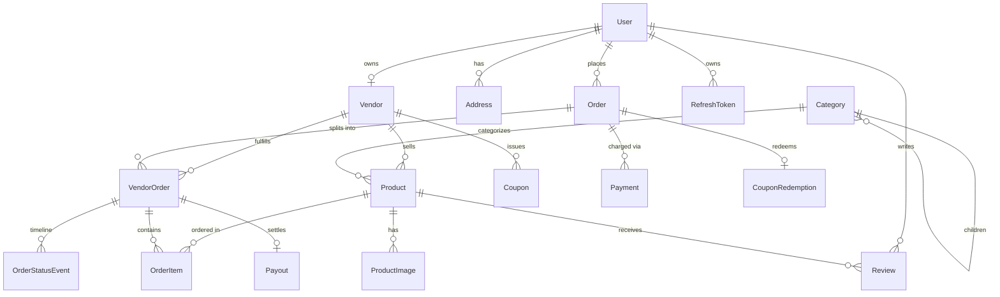

# Haat (हाट) — Multi-Vendor E-Commerce Marketplace

[](https://github.com/haat-marketplace/haat/actions)
[](https://www.typescriptlang.org/)
[](https://react.dev/)
[](https://nodejs.org/)
[](https://www.prisma.io/)
[](https://tailwindcss.com/)

**Haat** (*Hindi for a vibrant local market where independent sellers trade together*) is an enterprise-grade multi-vendor e-commerce platform. It enables independent artisans, specialized brands, and merchants to sell directly to customers through a unified cart, automated split escrow payments, independent vendor fulfillment lifecycles, and verified reviews.

---

## 1. Architecture

```
┌────────────────────────────────┐         HTTPS          ┌──────────────────────────────────┐
│   React 18 + Vite + Tailwind   │ ─────────────────────▶ │   Express API (TypeScript)       │
│   (Storefront & Dashboards)    │ ◀───────────────────── │   Modular Monolith               │
└────────────────────────────────┘          JSON          └───┬──────┬──────┬──────┬───────┬──┘
                                                              │      │      │      │       │
                                                           Postgres Redis   ES     S3   Razorpay
                                                           (Prisma) (Cart/ (Search (CDN   (Split
                                                                     Cache)  Index) Uploads) Route)
```

### Key Design Decisions & Trade-Offs

| Decision | Choice | Why |
|---|---|---|
| **Architecture** | Modular Monolith | High cohesion, zero distributed network latency, clear domain boundaries (`routes → controller → service → db`). |
| **Order Model** | `Order` → many `VendorOrder` | A single cart checkout containing items from 3 vendors creates 1 customer order split into 3 independent vendor fulfillment orders with individual status timelines. |
| **Payment Split** | Single customer charge → per-vendor net transfers | One customer transaction cleanly settles per-vendor payouts minus platform commission (`commissionBps`). |
| **Accounting Invariant** | Integer paise + pro-rata discount allocation | Avoids IEEE 754 floating point errors. Any 1-paise discount remainder is allocated to the largest vendor so $\sum \text{vendorOrders} \equiv \text{order.total}$. |
| **Stock Concurrency** | Atomic SQL update decrement | `UPDATE product SET stock = stock - qty WHERE id = ? AND stock >= qty` prevents overselling under heavy concurrent checkouts. |
| **Cart Storage** | Redis hash enriched with Postgres live prices | Redis provides sub-millisecond cart reads with TTL expiration; live DB prices are attached on read so stale prices are never trusted. |
| **Search Driver** | Elasticsearch with Postgres fallback | Full autocomplete edge-ngram search with zero-downtime database fallback via `SEARCH_DRIVER=pg`. |
| **Auth Security** | Access JWT (15m) + httpOnly refresh cookie (7d) | Refresh token hashes stored in DB with automatic reuse detection (revoking all user sessions upon token replay). |

---

## 2. Entity-Relationship Diagram (ERD)



---

## 3. Quickstart (≤ 5 Commands)

```bash
# 1. Clone & setup environment variables
cp .env.example .env

# 2. Start PostgreSQL, Redis, Elasticsearch, and MinIO
docker compose up -d

# 3. Install workspace dependencies
pnpm install

# 4. Generate client, push database schema, and seed realistic catalog
pnpm db:setup

# 5. Start development servers (API on :4000, Web on :5173)
pnpm dev
```

Open **`http://localhost:5173`** in your browser.

---

## 4. Demo Credentials & Test Accounts

All demo accounts use password: **`Demo@1234`**

| Role | Email | Description |
|---|---|---|
| **Platform Admin** | `admin@haat.test` | Full platform KPIs, vendor approval queue, commission editor |
| **Approved Vendor** | `vendor1@haat.test` | Store: *Kavita Textiles & Crafts* (Products, Orders, Shipments) |
| **Approved Vendor** | `vendor2@haat.test` | Store: *Zenith Audio & Tech* |
| **Approved Vendor** | `vendor3@haat.test` | Store: *Clay & Copper Pottery* |
| **Verified Customer** | `customer@haat.test` | Multi-vendor order history, saved addresses, verified reviews |

> ⚡ *Tip:* The Sign In screen has **1-Click Demo Profile buttons** for instantaneous login testing.

---

## 5. End-to-End Demo Spine (5-Minute Tour)

1. **Customer Discovery:** Search for `"Silk"` or `"Headphones"` with live autocomplete suggestions.
2. **Multi-Vendor Cart:** Add the *Chanderi Silk Saree* (Kavita Textiles) and *Studio ANC Headphones* (Zenith Tech) to the cart.
3. **Discount Coupon:** Apply promo code **`WELCOME10`** for a 10% discount automatically distributed pro-rata across both vendors.
4. **Checkout & Split Payment:** Submit checkout. With `PAYMENT_PROVIDER=fake`, payment instantly captures, clearing the cart and reserving stock atomically.
5. **Vendor Fulfillment:** Log in as `vendor1@haat.test`, open **Store Orders**, mark the saree as **Packed**, then click **Ship Order** and enter tracking number `DTDC891024`.
6. **Customer Tracking & PDF Invoice:** Return to the customer account to inspect the vertical shipment timeline with status events, then click **Download Invoice** to stream an itemized GST-style PDF.
7. **Verified Review:** Once the vendor marks the item as `DELIVERED`, leave a verified 5-star review.
8. **Admin Analytics:** Log in as `admin@haat.test` to review overall GMV, commission earned, and vendor approval queue.

---

## 6. Testing

Run the automated test suite covering order state machine transitions, accounting invariants, RBAC security matrix, and webhook idempotency:

```bash
# Run unit & integration tests
pnpm test

# Run tests in API package directly
pnpm --filter api test
```

---

## 7. Project Structure

```
haat/
├── apps/
│   ├── api/
│   │   ├── prisma/             # schema.prisma, seed.ts
│   │   ├── src/
│   │   │   ├── config/         # env.ts (zod validated), logger.ts
│   │   │   ├── lib/            # prisma, redis, es, s3, razorpay provider
│   │   │   ├── middleware/     # auth, requireRole, validate, error, rateLimit
│   │   │   ├── modules/        # auth, vendors, products, search, cart,
│   │   │   │                   # checkout, payments, orders, reviews, coupons, admin
│   │   │   ├── jobs/           # expiry.ts (abandoned stock recovery), reindex.ts
│   │   │   ├── app.ts          # Express app definition (for supertest)
│   │   │   └── server.ts       # Server entry point
│   │   ├── test/               # vitest unit & integration test suites
│   │   └── Dockerfile
│   └── web/
│       ├── src/
│       │   ├── app/            # router.tsx, providers.tsx
│       │   ├── components/     # ui kit (Button, Input, Modal, Badge, Rating...)
│       │   ├── features/       # cart drawer, navbar, footer
│       │   ├── pages/          # Home, Search, ProductDetail, Cart, Checkout,
│       │   │                   # Orders, OrderDetail, VendorDashboard, Admin
│       │   └── lib/            # api (axios + refresh interceptor), money, contexts
│       ├── Dockerfile
│       └── nginx.conf
├── packages/
│   └── shared/                 # Zod schemas, state machine pure map, money helpers
├── docker-compose.yml          # Postgres, Redis, Elasticsearch, MinIO
├── .env.example
└── README.md
```

---

## 8. License

MIT License. Designed and engineered for high-reliability marketplace commerce.

